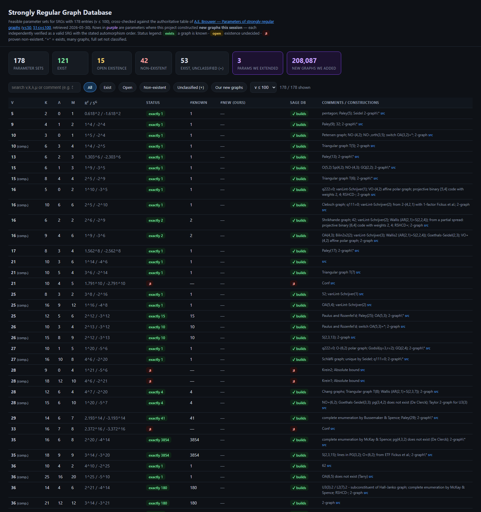

# SRG Database

A cross-checked database of **strongly regular graph** parameters (v ≤ 100), annotated with
**graphs constructed by Godsil–McKay switching** at four Brouwer-unclassified parameters — together with the draft
paper describing the construction and the graphs themselves. **Correction of 7 Nov 2026 below: the SRG(57,·) graphs
are not new.** The new **[SRG Library](library.html)** covers every parameter set up to v = 1300.

## View the database

Companion page **[`z3.html`](z3.html)** (2026-09-08): automorphisms of order 3 — every known SRG with an explicit order-3 action run through the orbit-matrix pipeline (filter, frame existence, generator, lift), and the fixed-point map of the open parameter sets (which f are impossible, closed, or open). Regenerate with `python3 build_z3.py`.

The main page is the **[SRG Library](library.html)** (every parameter set up to v = 1300; https://tonykoval.github.io/srg-database/). The earlier v ≤ 100 table is **[`v100.html`](v100.html)**; open it directly in a browser (it is fully self-contained — data
embedded, no server needed), or enable **GitHub Pages** (Settings → Pages → branch `main`) to
browse it at `https://tonykoval.github.io/srg-database/v100.html`.

The page lists 178 feasible SRG parameter sets, each cross-checked against two independent
authorities — A. E. Brouwer's table and the SageMath `strongly_regular_db` — with live search,
filters, and click-to-sort. The four parameters extended by this work are highlighted.

## Results

Cascading single-cell **Godsil–McKay switching** from low-automorphism seeds constructs large families of **asymmetric** strongly regular graphs at parameters that are known to be
realised but whose graphs are *not classified* (Brouwer "+"):

| Parameter | Graphs constructed | Verification and status |
|---|---|---|
| SRG(50,21,8,9) | 16,939 | valid; `\|Aut\|`∈{1,2}; **disjoint** from Spence's downloadable 18 |
| SRG(50,28,15,16) | 16,939 | complements of the above |
| SRG(49,24,11,12) | 535,728 (corrected count; pairwise non-isomorphic by nauty) | valid; `\|Aut\|`=1; overlap with the 2015 Mačaj–Kovaľ corpus not yet checked |
| SRG(57,24,11,9) | 1,122,556 | valid; `\|Aut\|`=1; **not new**: every one is the block graph of a Steiner triple system S(2,3,19) (19 Delsarte 9-cliques, each vertex in 3 of them), and all 11,084,874,829 STS(19) were classified by Kaski–Östergård (Math. Comp. 73 (2004), doi:10.1090/S0025-5718-04-01626-6); Ihringer lists 31,490,375 graphs on this row |
| SRG(57,32,16,20) | 1,122,556 | complements of SRG(57,24,11,9) — not new for the same reason |
| **Total** | **2,814,718** | of which 2,245,112 (the SRG(57,·) graphs) are known; the rest are lower bounds |

**Correction (7 Nov 2026).** Being asymmetric does not make a graph new: the SRG(57,·) graphs are Steiner-triple-system
block graphs and therefore among the 11,084,874,829 STS(19) classified by Kaski and Östergård (2004); the paper's novelty
argument does not cover that classification and is withdrawn for these two rows. The SRG(49,24,11,12) count is corrected to
535,728; its novelty is being re-checked against the 2015 corpus. The text below is the original May 2026 wording.

Every graph is asymmetric (`|Aut|` not divisible by 6), hence provably outside every published
prescribed-automorphism enumeration, and was independently re-verified by SageMath's
`is_strongly_regular()`. See the paper for the method, the cospectrality proof, the novelty
argument, and its honest limitations.

## Contents

- **[`library.html`](library.html)** — the SRG Library (v ≤ 1300); **[`v100.html`](v100.html)** — the earlier cross-checked v ≤ 100 table.
- **[`paper/`](paper/)** — the draft paper (PDF + LaTeX source): *Cascading Godsil–McKay
  Switching from Low-Symmetry Seeds: Constructing New Strongly Regular Graphs at Unclassified
  Parameters*.
- **[`catalogs/`](catalogs/)** — the constructed graphs in graph6 format (full SRG(50,…)
  catalogs; samples of the larger, still-growing SRG(49,…) and SRG(57,…) families).
- **[`docs/`](docs/)** — construction notes and a survey of the count literature & download
  sources.
- **[`data/`](data/)** — the Brouwer source tables and the SageMath existence verdicts, for audit.
- `build.py` — the generator that produces `v100.html` (run against the
  [orbit-gen](https://github.com/tonykoval/orbit-gen) working tree).

## Provenance

Constructed and verified 2026-05-30. Method, tooling, and full (large) catalogs live in the
[orbit-gen](https://github.com/tonykoval/orbit-gen) repository. Source of truth for the
parameter table: [A. E. Brouwer, *Parameters of strongly regular graphs*](https://aeb.win.tue.nl/graphs/srg/).

🤖 Generated with [Claude Code](https://claude.com/claude-code)
